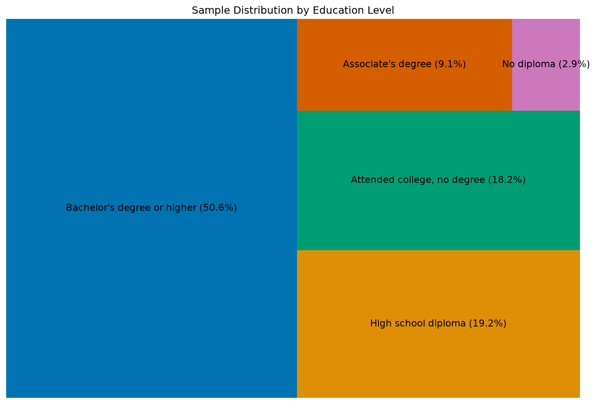
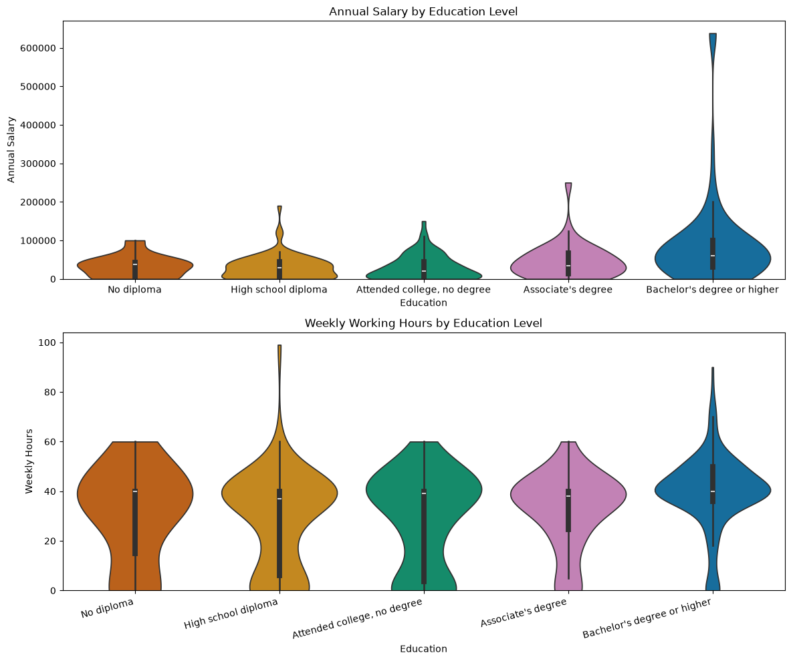
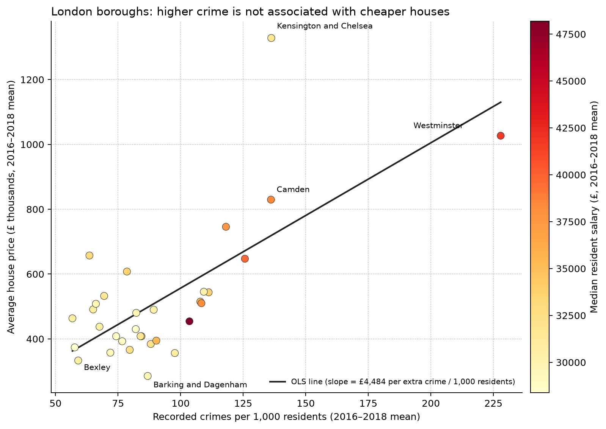
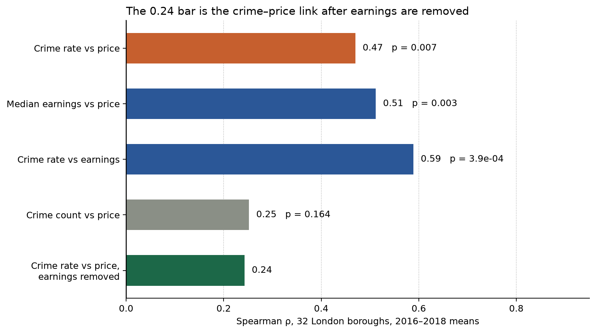

# WONG SI IEONG — Data Science Portfolio

## About Me
I am a Data Science student at the University of Macau. I am developing skills in Python, data analysis, and visualization, and my projects focus on turning a research question into a clear, reproducible analysis.

## Technical Skills
- **Programming**: Python, pandas, numpy, basic SQL
- **Visualization**: matplotlib, seaborn, squarify
- **Tools**: Jupyter Notebook, Anaconda, Git/GitHub
- **Data analysis**: data cleaning, exploratory data analysis, statistical plotting

## Featured Project: Education, Salary and Working Hours Analysis

### Research Question
Does a higher education level correspond to a higher annual salary, and how does education relate to weekly working hours? The analysis compares workers across five education groups, from "No diploma" to "Bachelor's degree or higher".

### Approach
I used pandas to load the course dataset and filter to workers aged under 65. I then summarized each education group by sample size, salary median and mean, and weekly hours median and mean. A treemap shows how the sample is distributed across education groups, and violin plots compare the salary and weekly hours distributions between groups.

### Visualization

### Findings
- Workers with a **Bachelor's degree or higher** have the highest salary distribution: median 61,000 and mean about 89,963 (n = 195).
- The other four groups have salary medians between about 20,400 and 38,000. Salary does not increase monotonically with education, and the "No diploma" group is small (n = 11).
- Weekly working hours are similar across groups (median 37–40 hours); the data do not show a clear monotonic relationship between education and hours.

### Limitation
This is observational data, so the plots show correlation rather than causation. Age, industry, and location are not controlled for. The dataset contains zero salary and zero hour values that were kept rather than separately coded, and some education groups are small. The currency unit is not stated in the source file.

### Project Repository
[View the code and README](https://github.com/wongsiieong/data-science-project)

### Status
Completed

## Team Project: Crime and House Prices in London Boroughs

### Research Question
In London, do boroughs with a higher recorded crime rate have lower average house prices? The analysis compares the 32 London boroughs using 2016–2018 means.

### My Role
This is a six-member team project (CISC7204 Class A, Team 05). I served as scribe and liaison: I assembled the interpretation from each member's analysis, prepared meeting minutes and recordings, and checked captions. The data processing, modelling, and code were produced jointly by the team.

### Approach
The team averaged monthly house prices to calendar years, summed crime counts, and computed a crime rate per 1,000 residents. Association was measured with Spearman's rank correlation, and a partial Spearman correlation residualised both rank series on median earnings. Tools: Python, pandas, NumPy, SciPy, and Matplotlib.

### Visualization

### Findings
- The crime rate and average price have a Spearman ρ of **0.47** (n = 32, p = 0.007). The association is positive: boroughs with more recorded crime per resident tend to have higher prices, not lower ones.
- Median earnings move with both price (ρ = 0.51, p = 0.003) and the crime rate (ρ = 0.59, p = 3.9e-04). After earnings are partialled out, the crime–price correlation falls to **0.24**.
- The raw crime count, without population adjustment, only reaches ρ = 0.25 (p = 0.164).

### Limitation
The result describes 32 boroughs in 2016–2018. It does not show that crime causes high prices, and it does not describe a street or a household. Earnings sit on both sides of the comparison, so the positive association is not a clean measure of crime's effect.

### Project Repository
[View the team repository](https://github.com/DeoxysD/cisc7204-london-boroughs)

### Status
Completed
